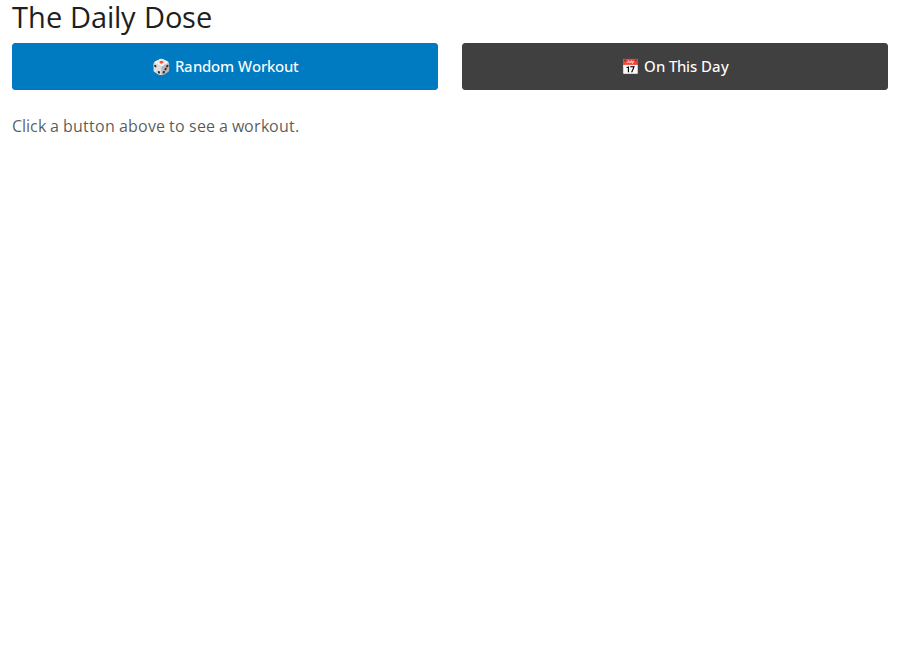

# daily-dose

A Shiny for Python app for browsing my personal workout log (2020-2024), converted from it's original R Markdown site. The does two things:

1.  **Random Workout**: pick one workout at random from the whole history
2.  **On This Day**: show every workout logged on today's month/day, across all years

Each workout is either typed markdown or a photo of the day's workout board/log.



## App

<https://mjfrigaard-daily-dose.share.connect.posit.cloud/>

## Install

Using `venv`:

``` bash
python3 -m venv .venv
source .venv/bin/activate
pip install -e ".[dev]"
```

Using `uv`:

``` bash
uv venv
uv pip install -e ".[dev]"
```

## Run

Using `venv` (with it activated):

``` bash
shiny run daily_dose.app:app --reload
```

Using `uv`:

``` bash
uv run shiny run daily_dose.app:app --reload
```

## Test

Using `venv` (with it activated):

``` bash
pytest
ruff check src tests app.py
mypy src app.py
```

Using `uv`:

``` bash
uv run pytest
uv run ruff check src tests app.py
uv run mypy src app.py
```

## Deploy

`app.py` and `requirements.txt` at the repo root exist only for [Posit Connect Cloud](https://docs.posit.co/connect-cloud/how-to/python/shiny-python.html), which expects both in those exact locations. Local development needs neither. The deploy how-to guide has the full steps.

## Docs

Docs are built with [great-docs](https://posit-dev.github.io/great-docs/) and organized by [Diátaxis](https://diataxis.fr/):\
- The `README.md` is the homepage\
- `tutorials/` is a guided first run\
- `how-to/` has task recipes for: - regenerating the workout data\
- updating screenshots\
- rebuilding the site\
- deploying to Posit Connect Cloud, and - running the test suite - `explanation/` covers design decisions\
- `reference/` is generated from `daily_dose.core`'s docstrings.

Build the whole site from the repo root:

``` bash
great-docs build
```