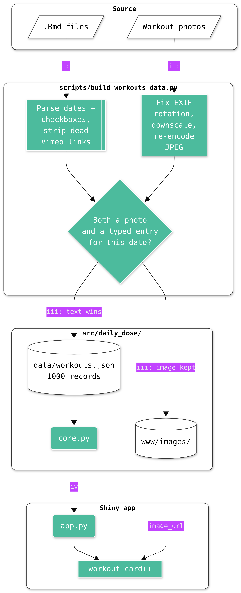

Background on why the `daily-dose` app/package is shaped the way it is. For instructions, see the [Tutorials](../tutorials/index.qmd) or [How-to Guides](../how-to/index.qmd). For exact signatures, see [Reference](../../reference/index.qmd).

## How a workout gets from source to screen

The sections below explain the decisions in this pipeline. This diagram tries to capture the whole thing:

```{mermaid}
%%| eval: false
%%| fig-width: 7
%%| fig-height: 9
%%| fig-align: 'center'
%%| fig-caption: 'How a workout gets from source to screen'
%%{init: {'theme': 'base', 'themeVariables': { 'fontFamily': 'monospace', "darkMode":true}}}%%
flowchart TD
    subgraph SourceGrp["<strong>Source</strong>"]
        Rmd[/".Rmd files"/]
        Photos[/"Workout photos"/]
    end

    subgraph BuildGrp["<strong>scripts/build_workouts_data.py</strong>"]
        Parse[["Parse dates +<br>checkboxes,<br>strip dead<br>Vimeo links"]]
        Rotate[["Fix EXIF<br>rotation,<br>downscale,<br>re-encode<br>JPEG"]]
        Dedup{"Both a photo<br>and a typed entry<br>for this date?"}
    end

    Rmd -->|"i:"| Parse
    Photos -->|"ii:"| Rotate
    Parse --> Dedup
    Rotate --> Dedup

    subgraph PkgGrp["<strong>src/daily_dose/</strong>"]
        Data[("data/workouts.json<br>1000 records")]
        Www[("www/images/")]
        Core("core.py")
    end

    Dedup -->|"iii: text wins"| Data
    Dedup -->|"iii: image kept"| Www
    Data --> Core

    subgraph AppGrp["<strong>Shiny app</strong>"]
        AppPy("app.py")
        Card[["workout_card()"]]
    end

    Core -->|"iv"| AppPy
    AppPy --> Card
    Www -.->|"image_url"| Card

    style Rmd fill:#FFFFFF,color:#000000,stroke:#333,rx:5,ry:5,font-size:16px
    style Photos fill:#FFFFFF,color:#000000,stroke:#333,rx:5,ry:5,font-size:16px
    style Parse fill:#4CBB9D,color:#FFFFFF,rx:5,ry:5,font-size:16px
    style Rotate fill:#4CBB9D,color:#FFFFFF,rx:5,ry:5,font-size:16px
    style Dedup fill:#4CBB9D,color:#FFFFFF,rx:5,ry:5,font-size:16px
    style Data fill:#FFFFFF,color:#000000,stroke:#333,rx:5,ry:5,font-size:16px
    style Www fill:#FFFFFF,color:#000000,stroke:#333,rx:5,ry:5,font-size:16px
    style Core fill:#4CBB9D,color:#FFFFFF,rx:5,ry:5,font-size:16px
    style AppPy fill:#4CBB9D,color:#FFFFFF,rx:5,ry:5,font-size:16px
    style Card fill:#4CBB9D,color:#FFFFFF,rx:5,ry:5,font-size:16px
    style SourceGrp fill:#FFFFFF,color:#000000,stroke:#333,stroke-width:1px,rx:10,ry:10,font-size:14px
    style BuildGrp fill:#FFFFFF,color:#000000,stroke:#333,stroke-width:1px,rx:10,ry:10,font-size:14px
    style PkgGrp fill:#FFFFFF,color:#000000,stroke:#333,stroke-width:1px,rx:10,ry:10,font-size:14px
    style AppGrp fill:#FFFFFF,color:#000000,stroke:#333,stroke-width:1px,rx:10,ry:10,font-size:14px

```



## Why just two features

I built the original site using R Markdown with a page per year, a `Notes` page, and a `Dev` page. When I convert it to a Python app, I kept the two things that make the personal workout log worth opening (a random pick, and "*what did I do on this day before*") instead of rebuilding a year-by-year browser nobody was asking for.

The `Notes` (training principles) and `Dev` (untested workout drafts, never real dated entries) were dropped for the same reason: neither is a *workout*, so neither belongs in a random pick or an on-this-day match.

## One record shape for two different sources

Roughly 4 years of the history is typed markdown, with a stretch of 2020 as whiteboard photos. Rather than model those as two separate collections, I decided to tread every workout as one record with a `date` and `kind` (`"text"` or `"image"`), and whichever fields apply to the *kind*. `random_workout()` and `on_this_day()` then both operate on a single flat list without caring what's inside each record. Only the rendering layer (`workout_card()`) branches on `kind`.

## Text wins when a date has both

Some 2020 dates turned out to have *both* a photographed whiteboard and a later typed write-up of the same session. In most cases, the photo was a same-day backup, typed up afterward. Keeping both would mean the same real workout showing up twice under "On This Day," and "Random Workout" silently double-weighting those dates. 

The build script resolves it by **preferring the text entry**, which is also the richer of the two because it usually includes the rep/set structure the photo doesn't make searchable.

## Recompressing the photos 

The original whiteboard photos were uncompressed phone-camera PNGs, some over 10MB each, 325MB total for 120 images. I wrote `daily-dose` to be a package that can be installed, not just a static site, so carrying that weight into every install wasn't worth it. 

Downscaling and re-encoding as JPEG dropped it to \~21MB, with no visible loss on what's essentially a photo of handwriting on a whiteboard.

## Shiny Core, not Express

The app is one server function wiring two buttons to two pure functions and a render call, small enough that Shiny for Python's Express terser syntax would save only a few lines. It's still built with Shiny Core, because `core.py` has no dependency on Shiny at all, and that's what makes `random_workout()` and `on_this_day()` unit-testable without spinning up a Shiny session (see `tests/test_core.py`). 

That separation is why `app.py` reads as thin glue rather than as the place the logic lives.

## The parser keeps things it can't fully understand

I spent four years writing down workout, but they don't use one consistent format for exercises, reps, or footnotes. Forcing that into structured fields would risk silently mangling every entry the parser couldn't read confidently.

`body_md` keeps the original markdown for each text entry verbatim and the app renders it as-is. The only fields pulled out are the two that are consistent enough to parse reliably: the date and the done-checkbox.

(Entries originally linked out to Vimeo for a video of the workout; that account is gone and every one of those links is now dead, so the build script unwraps them back down to plain text instead of shipping broken links.)

## The root `app.py` *and* `requirements.txt`

`pyproject.toml` is the real source of truth for dependencies, and local development never touches either root file. They exist only because [Posit Connect Cloud](https://docs.posit.co/connect-cloud/how-to/python/shiny-python.html) deploys by convention rather than configuration. 

Connect Cloud looks for an `app.py` at the repo root and installs from `requirements.txt`, full stop, with no way to point it at `src/daily_dose/app.py` or `pyproject.toml` instead.

Restructuring the package around one deployment target's assumptions didn't seem worth it. Instead, `app.py` is a small shim and `requirements.txt` holds *real* dependency lines mirroring `pyproject.toml`'s `[project.dependencies]` by hand. 

The first approach was `requirements.txt` containing just `-e .`, an editable install of the package from `pyproject.toml`, which kept the two files' *content* in sync automatically. That broke in production because Connect Cloud's dependency resolver doesn't run `pip install`, so it can't interpret `-e .` and fails before installing anything at all (`Error determining requirements: / does not appear to be a Python project`). 

Since `daily_dose` is never actually installed there either way, `app.py` puts `src/` on `sys.path` directly rather than relying on an install step to make the import work. The duplication is now in file *content*, not just file *existence* (a dependency added to `pyproject.toml` needs the same line added to `requirements.txt` by hand).