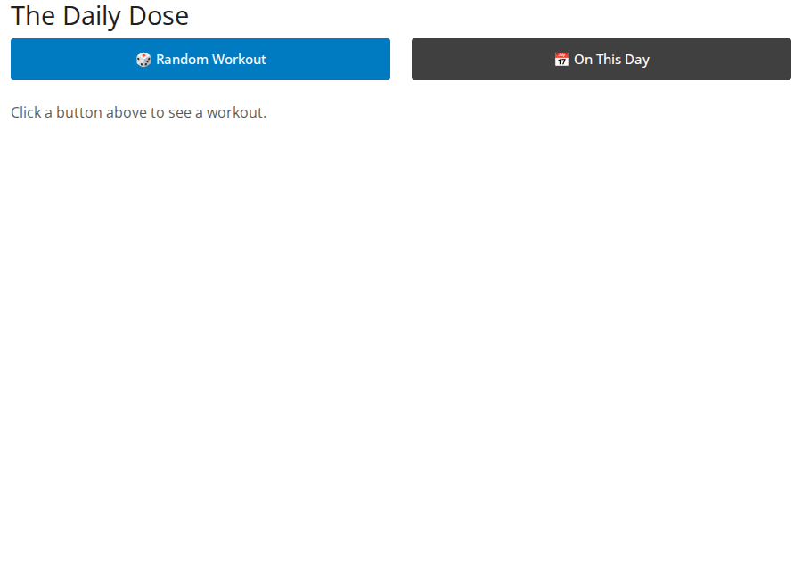
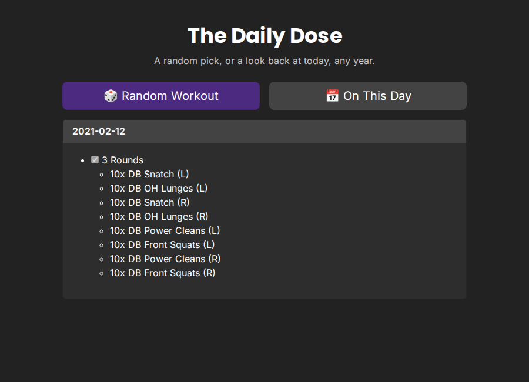
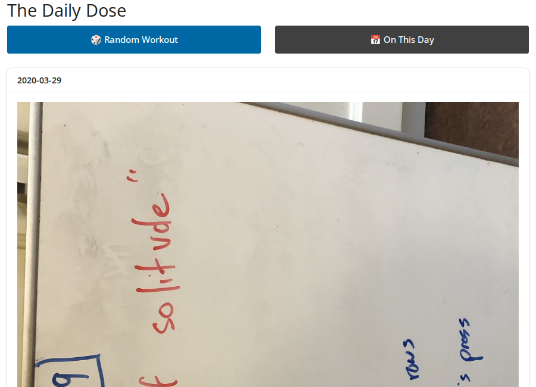
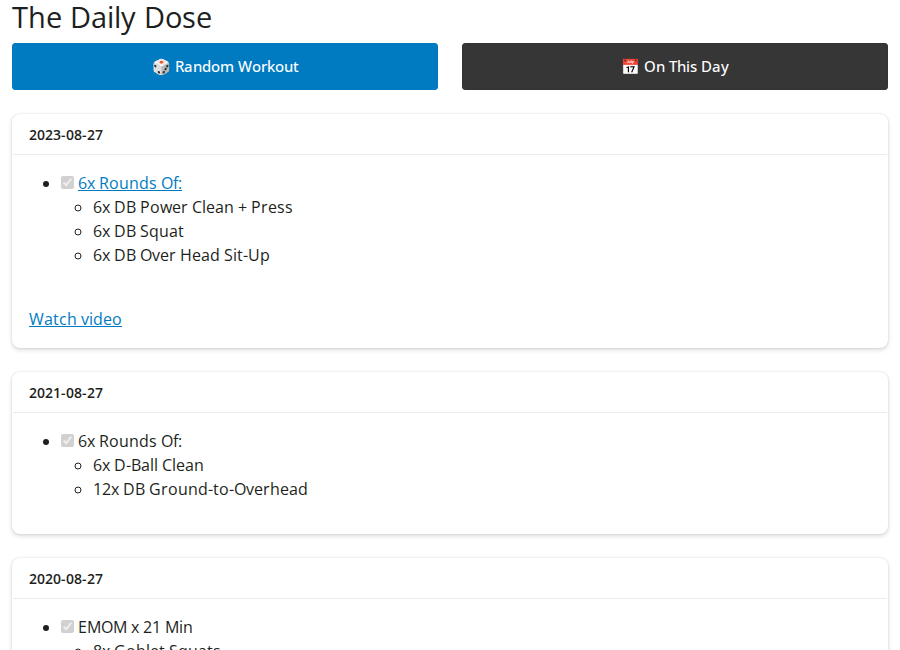

This tutorial covers how to clone the repo, install the dependencies, launch the app, and view a workout on your screen. By the end you'll have the app running locally and will have used both of its features.

## 1. Install

From the repo root, create a virtual environment and install the package with its `dev` extras:

``` bash
uv venv
uv pip install -e ".[dev]"
```

## 2. Launch the app

Start the development server, which reloads on every file change:

``` bash
shiny run daily_dose.app:app --reload
```

Open the URL Shiny prints (typically `http://127.0.0.1:8000`). You'll see the title and two buttons, and nothing else yet:



## 3. Get a random workout

Click **Random Workout**. A card appears with a date and the workout logged that day. Most days that's typed markdown:



Click it a few more times. Sooner or later you'll land on a workout from early-to-mid 2020, which I logged as a photograph of the whiteboard instead of typing it into markdown. The app shows both kinds the same way:



## 4. See what happened on this day

Click **On This Day**. The app scans every year (2020 - 2024) in the history for a workout logged on today's month and day, then shows every match it finds, most recent year first:



If today has no match, the app says so instead of showing an empty page.

## Next steps

- Need to add or re-derive the underlying workout data? See [How-to Guides](../how-to/index.qmd).
- Curious why the data is shaped the way it is? See [Explanation](../explanation/index.qmd).
- Want the exact function signatures behind these two buttons? See [Reference](../../reference/index.qmd).